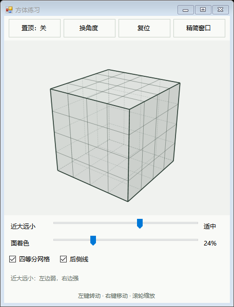
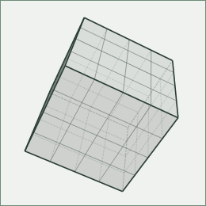

# 方体练习 · Cube Practice

一个用来观察透视、练习画方盒子的 Windows 小工具。选好角度后，方体会静止显示，方便放在绘画软件旁边慢慢临摹。

**[⬇ 下载 Windows 版 v1.0.0](https://github.com/yexikaheailante/cube-practice/raw/refs/heads/main/downloads/cube-practice-v1.0.0-windows.zip)** · [详细使用说明](使用说明.txt) · [反馈问题](https://github.com/yexikaheailante/cube-practice/issues)

下载 ZIP 后，先**解压整个文件夹**，再双击里面的 **`方体练习.exe`**。无需安装，无需联网。目前仅支持 Windows；构建及自动化检查已在作者本机 Windows 环境通过，其他设备的兼容性欢迎反馈。

## 可以做什么

- **自由转动、移动、缩放**：从不同角度观察方体，也可一键换角度。
- **调整近大远小**：滑块向右变化更明显，向左更弱；滚轮单独控制显示大小。
- **看清结构**：可开关四等分网格和后侧线，调整面的着色深浅；着色为 0% 时只保留线框。
- **边画边看**：窗口可置顶，也可切换为只显示方体的精简窗口。
- **记住设置**：关闭后保存角度、窗口位置、大小及外观设置。




## 常用操作

| 操作 | 功能 |
| --- | --- |
| 左键拖动 | 转动方体 |
| 右键或中键拖动 | 移动方体 |
| 滚轮 | 放大、缩小 |
| Shift + 左键拖动 | 绕视线方向转动 |
| 双击画面 | 回到中央，恢复显示大小 |
| R / Home / T | 换角度 / 复位 / 切换置顶 |
| Esc | 从精简模式恢复完整窗口 |
| 精简模式下 Ctrl + 左键拖动 | 移动整个窗口 |

精简窗口仍可拖动边缘调整大小，最小为 96 × 96。切换窗口模式不会改变方体角度和透视强度。

设置保存在程序旁边的 `偏好设置.xml`，请把解压后的文件夹放在有写入权限的位置。公开下载包不包含作者的个人设置。

## 从源码构建

源码使用 C#、Windows Forms 和 .NET Framework 4.x。构建脚本调用 Windows 的 64 位 .NET Framework 编译器，不需要安装额外的 NuGet 包。

在 Windows PowerShell 中进入项目目录，运行：

```powershell
.\build.ps1
```

程序输出到项目根目录的 `方体练习.exe`，与 `方体.ico` 放在同一文件夹即可使用。普通使用者直接下载上面的 ZIP 即可。

测试命令：

```powershell
.\tests\run-tests.ps1
.\tests\run-window-checks.ps1
```

前者检查透视投影、旋转和设置保存；后者检查窗口布局、置顶、精简模式及鼠标事件处理。窗口检查会生成 `tests/previews/` 预览图，不等同于完整的人工操作验收。

`src/make_icon.py` 仅用于重新生成图标，需要 Python 和 Pillow；构建程序时可直接使用仓库内已有图标。

## 文件结构

```text
src/          方体几何、绘制及窗口源码
tests/        几何和窗口检查
docs/images/  界面预览
downloads/    可直接使用的 Windows 压缩包及 SHA-256 校验值
build.ps1     Windows 构建脚本
使用说明.txt   随下载包提供的中文说明
```

## 关于

起因是学画画时画不明白方盒子，于是在 Codex 的帮助下做了这个自用参考工具。它提供可转动的方体参考，目前没有视平线标注、消失点辅助线或作业自动评分功能。

按 [MIT 许可证](LICENSE) 开源，欢迎使用、修改和反馈。
